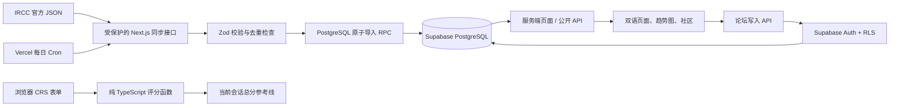

# 架构说明

## 技术与职责

Next.js 同时负责页面和 API，无需单独 Express 服务。服务端组件读取抽选与帖子，再将公开数据交给客户端筛选、图表和表单组件。Supabase Auth 管理身份，PostgreSQL 保存结构化数据，RLS 是数据权限的最后防线。

## 代码边界

- `app` 负责路由与请求入口，不存放评分公式。
- `features/crs`：输入校验、评分表与计算函数均可单独测试。React 表单只调用 `calculateCRS`。
- `features/draws/adapter.ts`：唯一理解 IRCC 原始字段的模块；解析结果统一为 `Draw`。
- `features/draws/sync.ts`：通过函数注入数据库操作，方便测试网络失败与无写入行为。
- `repository.ts`：只在服务器运行，负责数据来源切换和数据库读取。
- Supabase browser/server 客户端使用普通公钥和当前用户身份；只有同步模块可调用 admin 客户端。
- 论坛纯文本渲染，不支持任意 HTML；官方来源标签必须提供 HTTPS 的 canada.ca 域名链接。

## 数据模型

| 表                | 作用                                                    | 写权限                         |
| ----------------- | ------------------------------------------------------- | ------------------------------ |
| draws             | 编号、日期、类型、邀请人数、CRS、tie-breaking、官方来源 | 同步事务                       |
| profiles          | 公开昵称；不存邮箱或 CRS 背景                           | 新用户触发器；本人仅改昵称     |
| posts             | 主题、内容类型、标题、正文、来源、作者、隐藏状态        | 登录用户创建；作者改正文或删除 |
| comments          | 所属帖子、作者、正文、隐藏状态                          | 登录用户创建；作者改正文或删除 |
| admin_roles       | 管理员用户 ID                                           | 仅数据库受信任操作             |
| crs_rule_versions | 评分版本及核验来源                                      | 迁移或维护者                   |
| sync_runs         | 每次同步成功/失败和记录数                               | 服务端同步；管理员读           |
| data_status       | 最近检查、最近成功、状态摘要                            | 服务端同步；公开读             |

`profiles` 只公开 UUID、昵称和创建日期。账户邮箱保留在 Supabase Auth；不把邮箱复制到公开表。

帖子删除级联删除回复；用户删除级联删除其公开内容。隐藏帖子对公众不可见，作者可以看到隐藏状态，但不能自行取消隐藏。管理员通过专用 RPC 隐藏/恢复，不具有伪装作者修改内容的普通更新接口。

## 接口

| 方法与路径                   | 输入 / 输出                                       | 权限               |
| ---------------------------- | ------------------------------------------------- | ------------------ |
| GET /api/draws               | 抽选列表及 demo、updatedAt、checkedAt、syncFailed | 公开               |
| POST /api/posts              | title、body、topic、kind、source_url；返回 id     | 登录               |
| PATCH /api/posts/:id         | 同上；返回 id                                     | 作者               |
| DELETE /api/posts/:id        | 返回 ok                                           | 作者               |
| POST /api/posts/:id/comments | body；返回 id                                     | 登录且帖子公开     |
| PATCH /api/comments/:id      | body；返回 id                                     | 作者               |
| DELETE /api/comments/:id     | 返回 ok                                           | 作者               |
| PATCH /api/profile           | display_name                                      | 本人               |
| POST /api/admin/moderate     | content_type、content_id、hide                    | 管理员             |
| GET /api/cron/sync-draws     | 返回 ok、count                                    | Bearer CRON_SECRET |
| GET /auth/callback           | PKCE code；交换 session 后跳转                    | Auth 流程          |

写接口校验身份、同源 Origin、输入长度与字段。作者 ID 来自认证结果而非请求正文；数据库仍执行 RLS 和列级授权。管理员角色不能通过注册元数据、昵称接口或直接数据 API 获取。

## 同步失败与版本更新

完整解析一批数据后才调用导入 RPC。重复编号、无效日期、未来轮次、越界分数和不完整核心字段会拒绝整批。数据库 RPC 在一个事务中 upsert 数据、写日志、更新成功时间；失败则回滚。失败记录单独写入，最近成功时间保留。早期抽选没有 tie-breaking，显示“官方未提供”。

定时任务同时使用事务 advisory lock 和编号唯一约束，重复运行不会产生重复记录。管理员可在管理页查看最近 30 次运行；没有配置邮件告警。帖子及管理内容第一版显示最近 100 条；抽选读取上限 1000 条，远高于当前 445 条，后续超过上限时需要分页服务端读取。

更新 CRS 时：核验官方规则 → 更新 `rules.ts` 版本及表格 → 修改必要的计算分支 → 增加独立的预期值测试 → 新增数据库迁移记录版本 → 构建并重新部署。数据库版本表用于追溯，浏览器计算使用发布代码中的规则，不动态执行数据库脚本。
